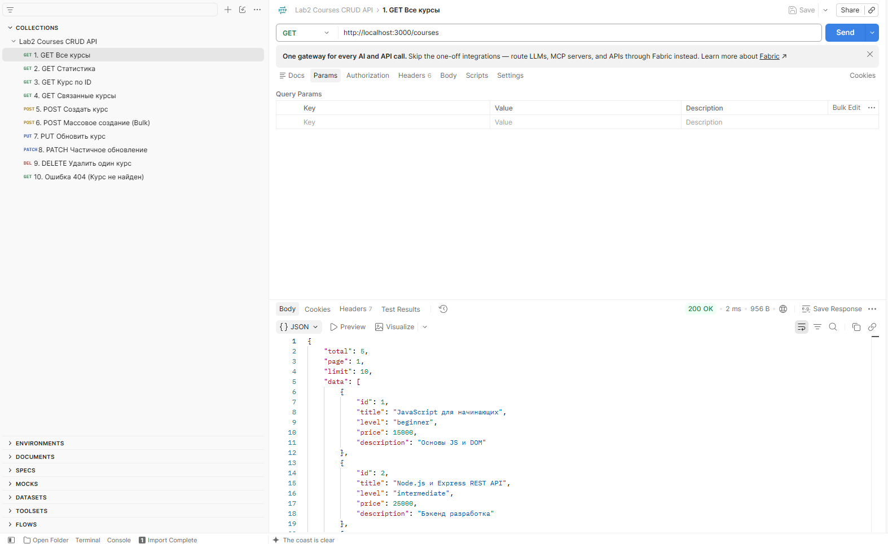
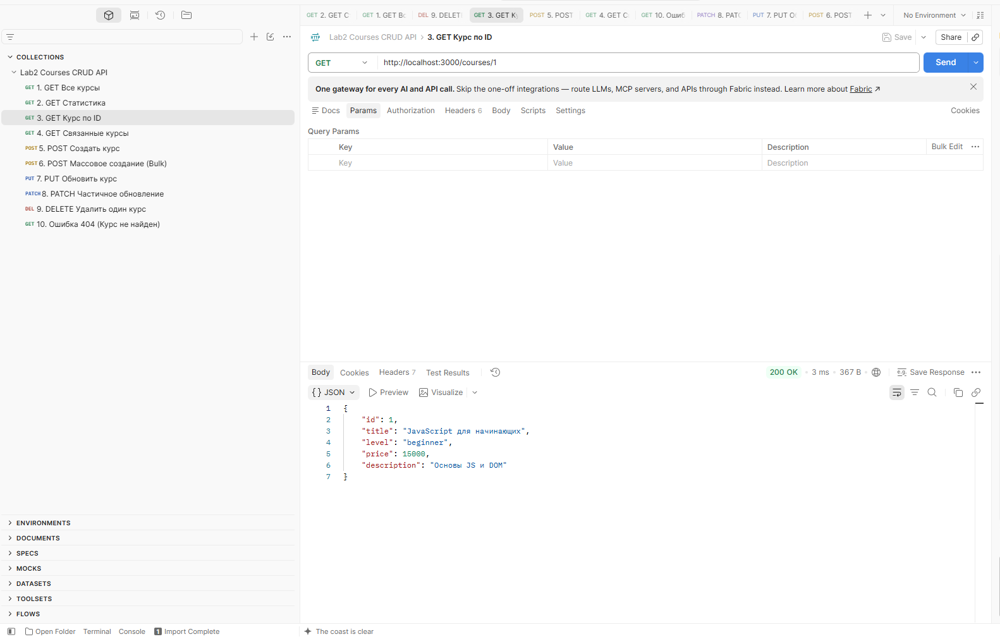
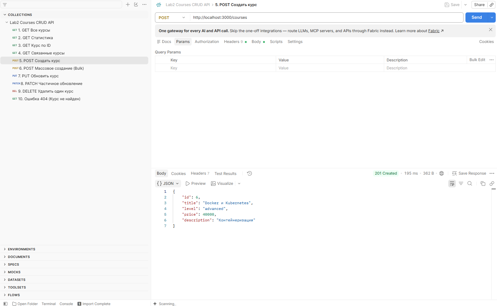
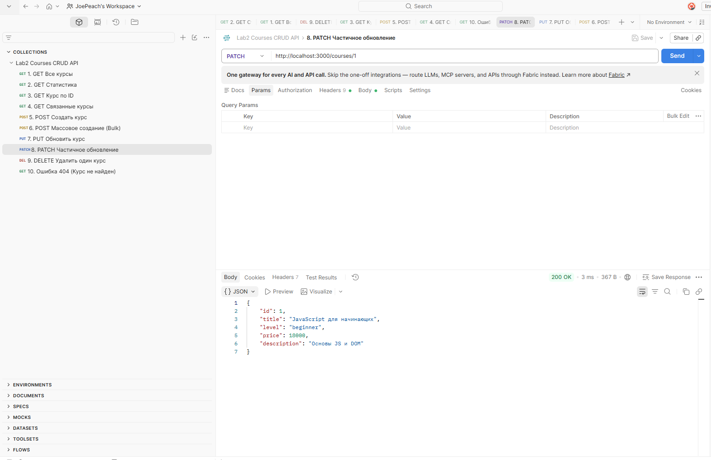
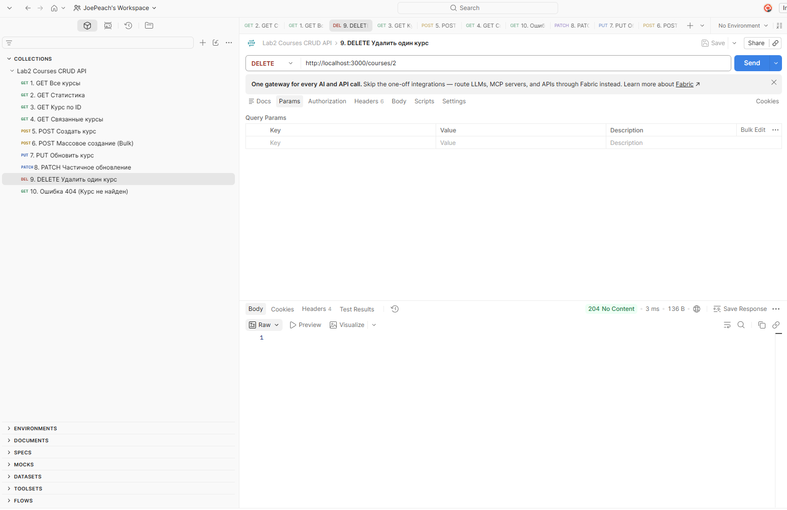
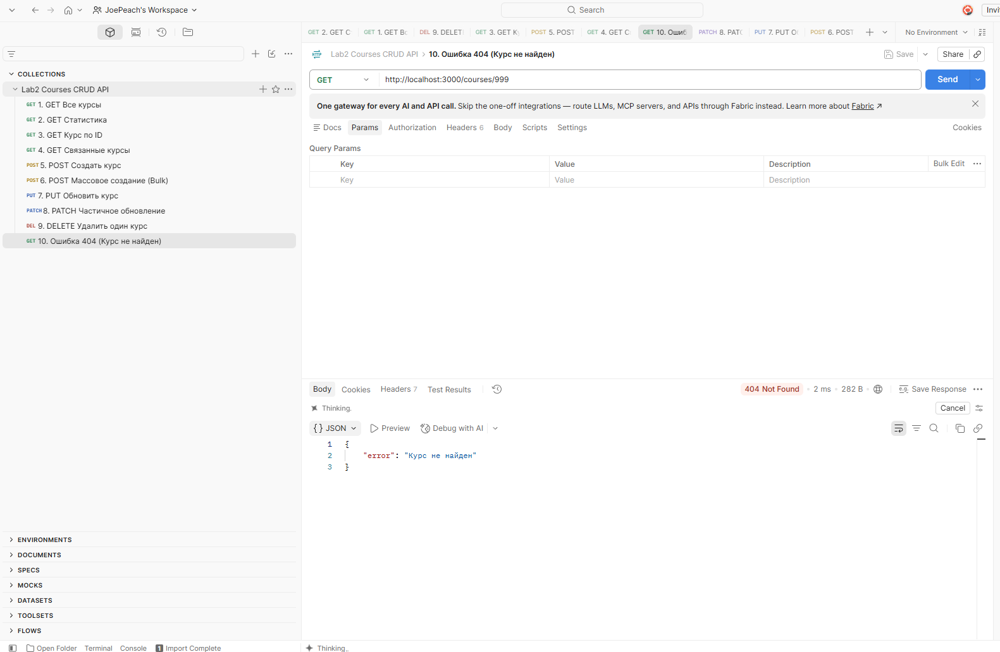
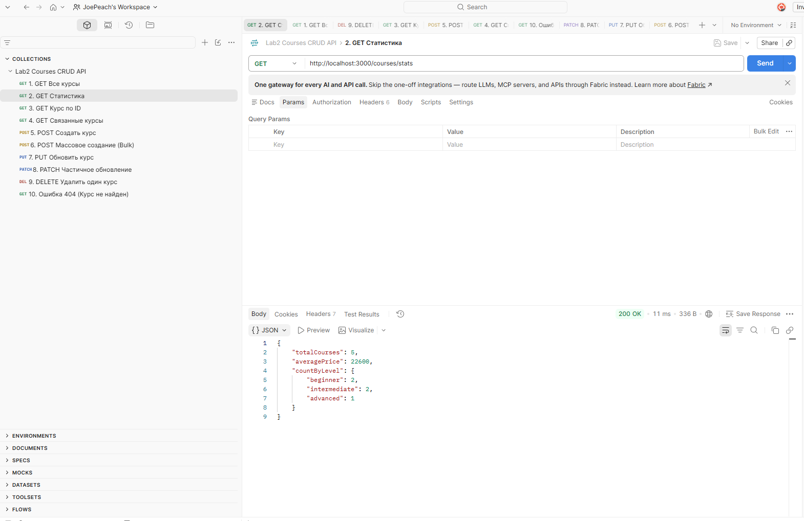
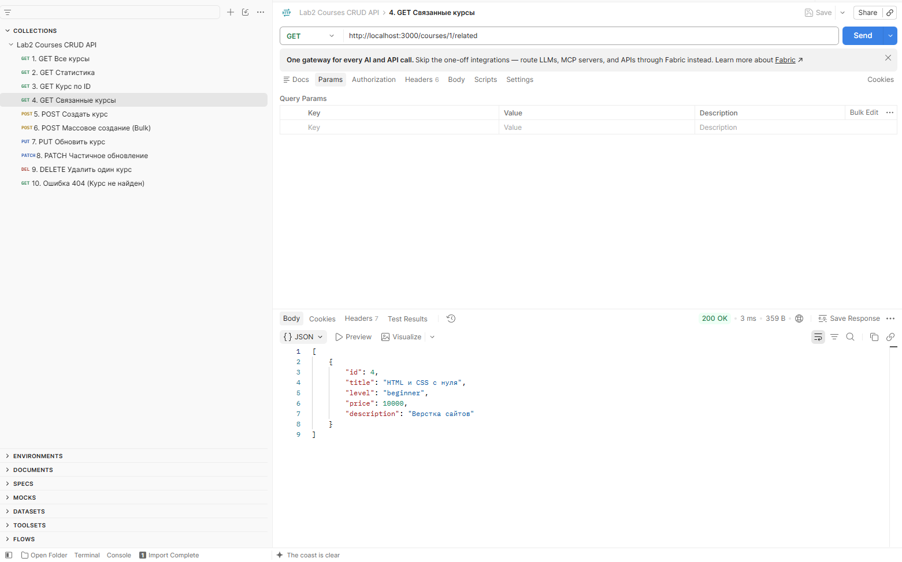
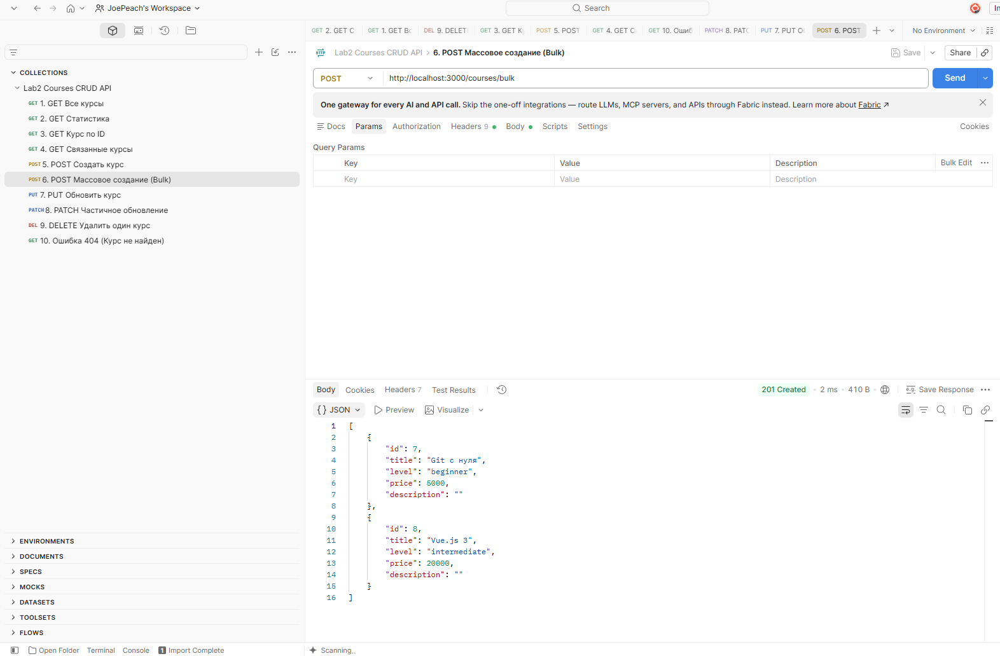

# Лабораторная работа №2: HTTP-методы: обработка GET, POST, PUT, DELETE

**Студент:** Романов Даниил Иванович
**Группа:** ПИЖ-б-о-25-2  
**Вариант:** 9  
**Технологии:** Node.js + Express, Postman

## Содержание

- [Цель работы](#цель-работы)
- [Теоретическое обоснование](#теоретическое-обоснование)
- [Структура проекта](#структура-проекта)
- [Установка и запуск](#установка-и-запуск)
- [Выполнение практического примера и создание коллекции Postman](#выполнение-практического-примера-и-создание-коллекции-postman)
  - [Описание API](#описание-api)
  - [Код JavaScript](#код-javascript)
  - [Скриншоты](#скриншоты)
- [Выполнение индивидуального задания — вариант 9](#выполнение-индивидуального-задания--вариант-9)
  - [Модель данных](#модель-данных)
  - [Реализованные эндпоинты](#реализованные-эндпоинты)
  - [Код индивидуального задания](#код-индивидуального-задания)
  - [Скриншоты результатов](#скриншоты-результатов)
- [Ответы на вопросы](#ответы-на-вопросы)
  - [Базовый уровень](#базовый-уровень)
  - [Средний уровень](#средний-уровень)
  - [Продвинутый уровень](#продвинутый-уровень)
- [Выводы](#выводы)


## Цель работы

Освоить обработку основных HTTP-методов (`GET`, `POST`, `PUT`, `PATCH`, `DELETE`) в Express. Научиться реализовывать CRUD-операции над коллекцией объектов, выполнять валидацию входных данных, реализовывать поиск, сортировку, пагинацию, массовое создание и удаление элементов, а также возвращать корректные HTTP-коды ответов.

## Теоретическое обоснование

**CRUD** — это акроним, обозначающий четыре базовые операции над данными:

- **Create** — создание;
- **Read** — чтение;
- **Update** — обновление;
- **Delete** — удаление.

В HTTP этим операциям обычно соответствуют:

| CRUD-операция | HTTP-метод |
|---|---|
| Create | `POST` |
| Read | `GET` |
| Update | `PUT`, `PATCH` |
| Delete | `DELETE` |

### GET

HTTP-метод `GET` используется для получения данных с сервера. Обычно параметры поиска, сортировки и пагинации передаются через query-параметры.

Пример:

```text
GET /courses
GET /courses/1
GET /courses?search=JavaScript
GET /courses?sort=price&order=desc&page=1&limit=10
```

Успешный запрос возвращает код `200 OK`.

### POST

Метод `POST` используется для создания нового ресурса.

Пример:

```text
POST /courses
```

Данные передаются в теле запроса в формате JSON. При успешном создании ресурса в проекте возвращается `201 Created`.

### PUT

Метод `PUT` используется для полного обновления существующего ресурса.

Пример:

```text
PUT /courses/1
```

При успешном обновлении возвращается обновлённый объект и код `200 OK`.

### PATCH

Метод `PATCH` используется для частичного обновления ресурса.

Например, можно изменить только цену курса:

```json
{
  "price": 18000
}
```

### DELETE

Метод `DELETE` используется для удаления ресурса.

В проекте реализованы два варианта:

```text
DELETE /courses
DELETE /courses/:id
```

После успешного удаления возвращается `204 No Content`.

### Middleware

**Middleware** — функция, которая выполняется между получением HTTP-запроса и формированием ответа.

В проекте используется:

```js
app.use(express.json());
```

Этот middleware позволяет Express разбирать JSON, переданный в теле запроса, и получать его через `req.body`.

Также реализован middleware для записи информации о запросах в файл `access.log`.

## Структура проекта

После размещения проекта в GitHub рекомендуется сохранить следующую структуру:

```text
lab2/
├── app.js
├── package.json
├── package-lock.json
├── courses_collection.json
├── access.log
├── scrin/
│   └── postman/
│       ├── all_courses.png
│       ├── courses_id.png
│       ├── create_course.png
│       ├── delete_courses.png
│       ├── error_courses.png
│       ├── mass_bulk.png
│       ├── partial_update.png
│       ├── Related_courses.png
│       ├── statistics.png
│       └── update_courses.png
└── README.md
```

> Папку `node_modules` в GitHub загружать не требуется. Её рекомендуется добавить в `.gitignore`.

## Установка и запуск

Для запуска проекта необходимо установить зависимости:

```bash
npm install
```

После установки запустить сервер:

```bash
node app.js
```

После запуска сервер будет доступен по адресу:

```text
http://localhost:3000
```

Для проверки API можно использовать Postman.

## Выполнение практического примера и создание коллекции Postman

В качестве практического примера реализовано REST API для работы с коллекцией курсов.

Каждый курс содержит следующие поля:

```json
{
  "id": 1,
  "title": "JavaScript для начинающих",
  "level": "beginner",
  "price": 15000,
  "description": "Основы JS и DOM"
}
```

В проекте используется хранение данных в памяти сервера. Поэтому после перезапуска приложения изменения коллекции будут потеряны, а массив курсов вернётся к начальному состоянию.

### Описание API

| Метод | URL | Назначение | Успешный код |
|---|---|---|---|
| GET | `/courses` | Получить список курсов | `200` |
| GET | `/courses/:id` | Получить курс по ID | `200` |
| GET | `/courses/stats` | Получить статистику | `200` |
| GET | `/courses/:id/related` | Получить связанные курсы | `200` |
| POST | `/courses` | Создать курс | `201` |
| POST | `/courses/bulk` | Массово создать курсы | `201` |
| PUT | `/courses/:id` | Полностью обновить курс | `200` |
| PATCH | `/courses/:id` | Частично обновить курс | `200` |
| DELETE | `/courses/:id` | Удалить один курс | `204` |
| DELETE | `/courses` | Удалить все курсы | `204` |

### Код JavaScript

Основная реализация API находится в файле `app.js`.

```js
const express = require('express');
const fs = require('fs');
const path = require('path');

const app = express();
const PORT = 3000;

// Middleware для разбора JSON
app.use(express.json());

// --- Логирование в файл access.log ---
const logFilePath = path.join(__dirname, 'access.log');

app.use((req, res, next) => {
  const logEntry = `[${new Date().toISOString()}] ${req.method} ${req.url}\n`;

  fs.appendFile(logFilePath, logEntry, (err) => {
    if (err) console.error('Ошибка записи в log-файл:', err);
  });

  next();
});

// --- База данных в памяти ---
let courses = [
  {
    id: 1,
    title: 'JavaScript для начинающих',
    level: 'beginner',
    price: 15000,
    description: 'Основы JS и DOM'
  },
  {
    id: 2,
    title: 'Node.js и Express REST API',
    level: 'intermediate',
    price: 25000,
    description: 'Бэкенд разработка'
  },
  {
    id: 3,
    title: 'Продвинутый React и Redux',
    level: 'advanced',
    price: 35000,
    description: 'Архитектура фронтенд приложений'
  },
  {
    id: 4,
    title: 'HTML и CSS с нуля',
    level: 'beginner',
    price: 10000,
    description: 'Верстка сайтов'
  },
  {
    id: 5,
    title: 'TypeScript в деталях',
    level: 'intermediate',
    price: 28000,
    description: 'Типизация в JS'
  }
];

let nextId = 6;

const ALLOWED_LEVELS = [
  'beginner',
  'intermediate',
  'advanced',
  'базовый',
  'средний',
  'продвинутый'
];

// --- Валидация данных курса ---
function validateCourseData(data, isPartial = false) {
  const errors = [];

  if (!isPartial || data.title !== undefined) {
    if (
      !data.title ||
      typeof data.title !== 'string' ||
      data.title.trim() === ''
    ) {
      errors.push(
        'Поле "title" обязательно и должно быть непустой строкой.'
      );
    }
  }

  if (!isPartial || data.level !== undefined) {
    if (
      !data.level ||
      typeof data.level !== 'string' ||
      !ALLOWED_LEVELS.includes(data.level.toLowerCase())
    ) {
      errors.push(
        `Поле "level" обязательно. Допустимые значения: ${ALLOWED_LEVELS.join(', ')}.`
      );
    }
  }

  if (!isPartial || data.price !== undefined) {
    if (
      data.price === undefined ||
      typeof data.price !== 'number' ||
      data.price < 0
    ) {
      errors.push(
        'Поле "price" обязательно и должно быть неотрицательным числом.'
      );
    }
  }

  return errors;
}

// GET /courses/stats
app.get('/courses/stats', (req, res) => {
  const totalCount = courses.length;

  const countByLevel = courses.reduce((acc, course) => {
    const lvl = course.level.toLowerCase();
    acc[lvl] = (acc[lvl] || 0) + 1;
    return acc;
  }, {});

  const totalPrice = courses.reduce((sum, course) => sum + course.price, 0);
  const averagePrice =
    totalCount > 0 ? Number((totalPrice / totalCount).toFixed(2)) : 0;

  res.json({
    totalCourses: totalCount,
    averagePrice,
    countByLevel
  });
});

// POST /courses/bulk
app.post('/courses/bulk', (req, res) => {
  const items = req.body;

  if (!Array.isArray(items) || items.length === 0) {
    return res.status(400).json({
      error: 'Тело запроса должно содержать непустой массив элементов.'
    });
  }

  const createdCourses = [];

  for (let i = 0; i < items.length; i++) {
    const errors = validateCourseData(items[i]);

    if (errors.length > 0) {
      return res.status(400).json({
        error: `Ошибка валидации в элементе с индексом ${i}`,
        details: errors
      });
    }
  }

  items.forEach(item => {
    const newCourse = {
      id: nextId++,
      title: item.title.trim(),
      level: item.level.toLowerCase(),
      price: item.price,
      description: item.description || ''
    };

    courses.push(newCourse);
    createdCourses.push(newCourse);
  });

  res.status(201).json(createdCourses);
});

// GET /courses
app.get('/courses', (req, res) => {
  let result = [...courses];

  const { search, sort, order, page, limit } = req.query;

  // Поиск
  if (search) {
    const searchLower = search.toLowerCase();

    result = result.filter(course =>
      course.title.toLowerCase().includes(searchLower)
    );
  }

  // Сортировка
  if (sort) {
    const sortOrder = order === 'desc' ? -1 : 1;

    result.sort((a, b) => {
      if (a[sort] < b[sort]) return -1 * sortOrder;
      if (a[sort] > b[sort]) return 1 * sortOrder;

      return 0;
    });
  }

  // Пагинация
  const pageNum = parseInt(page, 10) || 1;
  const limitNum = parseInt(limit, 10) || 10;

  const startIndex = (pageNum - 1) * limitNum;
  const endIndex = pageNum * limitNum;

  const paginatedResult = result.slice(startIndex, endIndex);

  res.json({
    total: result.length,
    page: pageNum,
    limit: limitNum,
    data: paginatedResult
  });
});

// GET /courses/:id/related
app.get('/courses/:id/related', (req, res) => {
  const id = parseInt(req.params.id, 10);
  const targetCourse = courses.find(course => course.id === id);

  if (!targetCourse) {
    return res.status(404).json({
      error: 'Курс не найден'
    });
  }

  const related = courses.filter(
    course =>
      course.level.toLowerCase() === targetCourse.level.toLowerCase() &&
      course.id !== targetCourse.id
  );

  res.json(related);
});

// GET /courses/:id
app.get('/courses/:id', (req, res) => {
  const id = parseInt(req.params.id, 10);
  const course = courses.find(course => course.id === id);

  if (!course) {
    return res.status(404).json({
      error: 'Курс не найден'
    });
  }

  res.json(course);
});

// POST /courses
app.post('/courses', (req, res) => {
  const errors = validateCourseData(req.body);

  if (errors.length > 0) {
    return res.status(400).json({ errors });
  }

  const newCourse = {
    id: nextId++,
    title: req.body.title.trim(),
    level: req.body.level.toLowerCase(),
    price: req.body.price,
    description: req.body.description || ''
  };

  courses.push(newCourse);

  res.status(201).json(newCourse);
});

// PUT /courses/:id
app.put('/courses/:id', (req, res) => {
  const id = parseInt(req.params.id, 10);
  const index = courses.findIndex(course => course.id === id);

  if (index === -1) {
    return res.status(404).json({
      error: 'Курс не найден'
    });
  }

  const errors = validateCourseData(req.body);

  if (errors.length > 0) {
    return res.status(400).json({ errors });
  }

  courses[index] = {
    id,
    title: req.body.title.trim(),
    level: req.body.level.toLowerCase(),
    price: req.body.price,
    description: req.body.description || ''
  };

  res.json(courses[index]);
});

// PATCH /courses/:id
app.patch('/courses/:id', (req, res) => {
  const id = parseInt(req.params.id, 10);
  const course = courses.find(course => course.id === id);

  if (!course) {
    return res.status(404).json({
      error: 'Курс не найден'
    });
  }

  const errors = validateCourseData(req.body, true);

  if (errors.length > 0) {
    return res.status(400).json({ errors });
  }

  if (req.body.title !== undefined) {
    course.title = req.body.title.trim();
  }

  if (req.body.level !== undefined) {
    course.level = req.body.level.toLowerCase();
  }

  if (req.body.price !== undefined) {
    course.price = req.body.price;
  }

  if (req.body.description !== undefined) {
    course.description = req.body.description;
  }

  res.json(course);
});

// DELETE /courses
app.delete('/courses', (req, res) => {
  courses = [];
  res.status(204).send();
});

// DELETE /courses/:id
app.delete('/courses/:id', (req, res) => {
  const id = parseInt(req.params.id, 10);
  const index = courses.findIndex(course => course.id === id);

  if (index === -1) {
    return res.status(404).json({
      error: 'Курс не найден'
    });
  }

  courses.splice(index, 1);

  res.status(204).send();
});

// Глобальный обработчик ошибок
app.use((err, req, res, next) => {
  console.error(err.stack);

  res.status(500).json({
    error: 'Внутренняя ошибка сервера (500 Internal Server Error)'
  });
});

// Запуск сервера
app.listen(PORT, () => {
  console.log(`Сервер запущен на http://localhost:${PORT}`);
});
```

### Скриншоты

Проверка основных запросов была выполнена с помощью Postman.

#### Получение всех курсов



*Получение списка всех курсов методом GET.*

---

#### Получение курса по ID



*Получение одного курса методом GET.*

---

#### Создание курса



*Создание нового курса методом POST.*

---

#### Обновление курса


*Полное обновление существующего курса методом PUT.*

---

#### Частичное обновление курса



*Частичное изменение курса методом PATCH.*

---

#### Удаление курса



*Удаление курса методом DELETE.*

---

#### Ошибка 404



*Обработка запроса к несуществующему курсу.*

---

## Выполнение индивидуального задания — вариант 9

В рамках индивидуального задания реализован REST API для коллекции **курсов**.

Основные поля сущности:

- `id` — уникальный идентификатор курса;
- `title` — название курса;
- `level` — уровень сложности;
- `price` — стоимость;
- `description` — описание курса.

### Модель данных

Начальная коллекция содержит пять курсов:

```json
[
  {
    "id": 1,
    "title": "JavaScript для начинающих",
    "level": "beginner",
    "price": 15000,
    "description": "Основы JS и DOM"
  },
  {
    "id": 2,
    "title": "Node.js и Express REST API",
    "level": "intermediate",
    "price": 25000,
    "description": "Бэкенд разработка"
  },
  {
    "id": 3,
    "title": "Продвинутый React и Redux",
    "level": "advanced",
    "price": 35000,
    "description": "Архитектура фронтенд приложений"
  },
  {
    "id": 4,
    "title": "HTML и CSS с нуля",
    "level": "beginner",
    "price": 10000,
    "description": "Верстка сайтов"
  },
  {
    "id": 5,
    "title": "TypeScript в деталях",
    "level": "intermediate",
    "price": 28000,
    "description": "Типизация в JS"
  }
]
```

### Реализованные эндпоинты

#### Базовые операции

- `GET /courses` — получение списка курсов;
- `GET /courses/:id` — получение одного курса;
- `POST /courses` — создание курса;
- `PUT /courses/:id` — полное обновление курса;
- `DELETE /courses/:id` — удаление курса.

Также предусмотрена обработка ошибки `404 Not Found`, если курс с указанным ID отсутствует.

#### Средний уровень

Дополнительно реализованы:

- `GET /courses?search=...` — поиск курса по названию;
- `GET /courses?sort=field&order=asc|desc` — сортировка;
- `GET /courses?page=1&limit=10` — пагинация;
- валидация обязательных полей;
- проверка типов данных;
- проверка допустимых значений `level`;
- `PATCH /courses/:id` — частичное обновление;
- `204 No Content` при успешном удалении.

#### Продвинутый уровень

В проекте реализованы дополнительные возможности:

- `DELETE /courses` — удаление всех курсов;
- `POST /courses/bulk` — массовое создание курсов;
- `GET /courses/stats` — статистика по коллекции;
- `GET /courses/:id/related` — поиск связанных курсов;
- глобальный обработчик ошибок `500 Internal Server Error`;
- логирование HTTP-запросов в `access.log`.

### Особенности варианта 9

Для варианта 9 реализованы следующие специализированные операции.

#### Статистика

Эндпоинт:

```text
GET /courses/stats
```

Возвращает:

- общее количество курсов;
- среднюю стоимость курса;
- количество курсов каждого уровня.

Пример ответа:

```json
{
  "totalCourses": 5,
  "averagePrice": 24600,
  "countByLevel": {
    "beginner": 2,
    "intermediate": 2,
    "advanced": 1
  }
}
```

#### Связанные курсы

Эндпоинт:

```text
GET /courses/1/related
```

Связанными считаются курсы, имеющие такой же `level`, что и выбранный курс.

Например, для курса с уровнем `beginner` будут найдены другие курсы с уровнем `beginner`.

### Код индивидуального задания

Весь код индивидуального задания находится в файле `app.js`.

Полная реализация включает:

- middleware `express.json()`;
- middleware логирования;
- хранение курсов в памяти;
- валидацию данных;
- CRUD-операции;
- поиск;
- сортировку;
- пагинацию;
- статистику;
- связанные элементы;
- массовое создание;
- массовое удаление;
- обработку ошибок `404` и `500`.

### Скриншоты результатов

#### Получение всех курсов


*Результат выполнения `GET /courses`.*

---

#### Статистика



*Результат выполнения `GET /courses/stats`.*

---

#### Получение курса по ID


*Результат выполнения `GET /courses/:id`.*

---

#### Связанные курсы



*Результат выполнения запроса связанных курсов. Для варианта 9 связь выполняется по полю `level`.*

---

#### Создание курса


*Результат выполнения `POST /courses`.*

---

#### Массовое создание



*Результат выполнения `POST /courses/bulk`.*

---

#### Полное обновление


*Результат выполнения `PUT /courses/:id`.*

---

#### Частичное обновление


*Результат выполнения `PATCH /courses/:id`.*

---

#### Удаление курса


*Результат выполнения `DELETE /courses/:id`.*

---

#### Обработка ошибки 404


*Результат выполнения запроса к несуществующему курсу.*

## Ответы на вопросы

### Базовый уровень

**1. Что такое CRUD? Расшифруйте каждую букву.**

**Ответ:** CRUD — четыре основные операции работы с данными: Create, Read, Update, Delete.

**2. Какие HTTP-методы соответствуют операциям CRUD?**

**Ответ:**

- Create — `POST`;
- Read — `GET`;
- Update — `PUT`, `PATCH`;
- Delete — `DELETE`.

**3. Что такое идемпотентность HTTP-методов? Какие методы идемпотентны?**

**Ответ:** идемпотентность — свойство HTTP-метода, при котором повторное выполнение одного и того же запроса имеет тот же конечный эффект на сервере, что и однократное выполнение. К идемпотентным относятся `GET`, `PUT` и `DELETE`. `PATCH` в общем случае не гарантирует идемпотентность.

**4. Какой код ответа возвращается при успешном создании ресурса?**

**Ответ:** `201 Created`.

**5. Какой код ответа возвращается при успешном удалении ресурса в данной работе?**

**Ответ:** `204 No Content`.

**6. Что такое middleware в Express? Для чего используется `express.json()`?**

**Ответ:** middleware — функция, которая выполняется в процессе обработки HTTP-запроса. `express.json()` используется для разбора JSON из тела запроса и предоставляет полученные данные через `req.body`.

**7. Как получить параметры из тела POST-запроса в Express?**

**Ответ:** через `req.body`.

**8. Как получить параметр из URL, например ID?**

**Ответ:** через `req.params`. Например:

```js
const id = parseInt(req.params.id, 10);
```

**9. Как найти элемент в массиве по ID?**

**Ответ:** с помощью метода `find()`:

```js
const course = courses.find(course => course.id === id);
```

**10. Какой код ответа возвращается, если ресурс не найден?**

**Ответ:** `404 Not Found`.

**11. Как отправить JSON-ответ в Express?**

**Ответ:** с помощью:

```js
res.json(data);
```

**12. Как вернуть статус-код 201 в Express?**

**Ответ:**

```js
res.status(201).json(data);
```

**13. Что произойдёт с данными в памяти при перезапуске сервера?**

**Ответ:** данные, изменённые во время работы сервера, будут потеряны, поскольку коллекция `courses` хранится только в памяти процесса Node.js.

**14. Как добавить новый элемент в массив?**

**Ответ:** с помощью метода `push()`:

```js
courses.push(newCourse);
```

**15. Как удалить элемент из массива?**

**Ответ:** в данной работе используется метод `splice()`:

```js
courses.splice(index, 1);
```

### Средний уровень

**1. В чём разница между PUT и PATCH?**

**Ответ:** `PUT` используется для полного обновления ресурса, а `PATCH` — для частичного обновления отдельных полей.

**2. Как реализовать поиск по коллекции с помощью query-параметра `search`?**

**Ответ:** необходимо получить `search` из `req.query` и отфильтровать массив по названию курса:

```js
const { search } = req.query;

if (search) {
  const searchLower = search.toLowerCase();

  result = result.filter(course =>
    course.title.toLowerCase().includes(searchLower)
  );
}
```

**3. Как реализовать сортировку по полю?**

**Ответ:** поле сортировки и направление передаются через `req.query`. После этого используется метод `sort()`:

```js
const { sort, order } = req.query;

if (sort) {
  const sortOrder = order === 'desc' ? -1 : 1;

  result.sort((a, b) => {
    if (a[sort] < b[sort]) return -1 * sortOrder;
    if (a[sort] > b[sort]) return 1 * sortOrder;

    return 0;
  });
}
```

**4. Как реализовать пагинацию?**

**Ответ:** используются параметры `page` и `limit`, после чего вычисляются начальный и конечный индексы:

```js
const pageNum = parseInt(page, 10) || 1;
const limitNum = parseInt(limit, 10) || 10;

const startIndex = (pageNum - 1) * limitNum;
const endIndex = pageNum * limitNum;

const paginatedResult = result.slice(startIndex, endIndex);
```

**5. Как валидировать входные данные?**

**Ответ:** в проекте создана функция `validateCourseData()`, которая проверяет наличие и типы полей `title`, `level` и `price`.

Например:

```js
if (
  data.price === undefined ||
  typeof data.price !== 'number' ||
  data.price < 0
) {
  errors.push(
    'Поле "price" обязательно и должно быть неотрицательным числом.'
  );
}
```

**6. Какие коды ответов используются при ошибках валидации?**

**Ответ:** `400 Bad Request`. Если запрошенный курс отсутствует, используется `404 Not Found`.

**7. Как вернуть `204 No Content` при DELETE?**

**Ответ:**

```js
res.status(204).send();
```

**8. В чём разница между `res.json()` и `res.send()`?**

**Ответ:** `res.json()` отправляет ответ в формате JSON и автоматически устанавливает соответствующий `Content-Type`. `res.send()` является более универсальным методом отправки ответа и может использоваться для различных типов данных.

**9. Как избежать дублирования ID при создании новых элементов?**

**Ответ:** в проекте используется переменная `nextId`. При создании нового курса текущее значение используется как ID, после чего счётчик увеличивается:

```js
id: nextId++
```

**10. Что такое `express.json()` и почему без него `req.body` не будет автоматически содержать JSON?**

**Ответ:** `express.json()` — middleware Express для разбора JSON-тела HTTP-запроса. Без этого middleware Express не будет автоматически преобразовывать JSON в объект JavaScript, доступный через `req.body`.

### Продвинутый уровень

**1. Как реализовать частичное обновление через PATCH?**

**Ответ:** сначала находится существующий курс по ID, затем проверяются только переданные поля. После успешной проверки изменяются соответствующие свойства объекта:

```js
if (req.body.title !== undefined) {
  course.title = req.body.title.trim();
}

if (req.body.level !== undefined) {
  course.level = req.body.level.toLowerCase();
}

if (req.body.price !== undefined) {
  course.price = req.body.price;
}

if (req.body.description !== undefined) {
  course.description = req.body.description;
}
```

**2. Как реализовать массовое удаление элементов?**

**Ответ:** в проекте реализован маршрут `DELETE /courses`, который очищает массив:

```js
app.delete('/courses', (req, res) => {
  courses = [];
  res.status(204).send();
});
```

**3. Как реализовать массовое создание элементов?**

**Ответ:** маршрут `POST /courses/bulk` принимает массив объектов, проверяет каждый объект с помощью `validateCourseData()`, после чего создаёт новые курсы и добавляет их в массив.

**4. Как реализовать глобальный обработчик ошибок?**

**Ответ:** в Express глобальный обработчик ошибок принимает четыре аргумента: `err`, `req`, `res`, `next`:

```js
app.use((err, req, res, next) => {
  console.error(err.stack);

  res.status(500).json({
    error: 'Внутренняя ошибка сервера (500 Internal Server Error)'
  });
});
```

**5. Как логировать HTTP-запросы в файл?**

**Ответ:** в проекте используется модуль `fs` и middleware, который записывает дату, HTTP-метод и URL в `access.log`:

```js
const logFilePath = path.join(__dirname, 'access.log');

app.use((req, res, next) => {
  const logEntry =
    `[${new Date().toISOString()}] ${req.method} ${req.url}\n`;

  fs.appendFile(logFilePath, logEntry, err => {
    if (err) {
      console.error('Ошибка записи в log-файл:', err);
    }
  });

  next();
});
```

**6. Что такое REST API и какие принципы лежат в его основе?**

**Ответ:** REST (Representational State Transfer) — архитектурный стиль построения веб-API, в котором работа выполняется с ресурсами, доступными по URL. Действия над ресурсами выражаются через HTTP-методы.

В данной работе ресурсом является курс, доступный через `/courses`.

**7. Как организовать структуру проекта для масштабируемого CRUD API?**

**Ответ:** при увеличении проекта код рекомендуется разделять по зонам ответственности: маршруты, контроллеры, бизнес-логика, модели данных, middleware и конфигурация. В текущей лабораторной работе реализация находится в одном файле `app.js`, что подходит для учебного проекта небольшого размера.

**8. Какие существуют стратегии генерации уникальных ID?**

**Ответ:** можно использовать:

- ручной счётчик;
- автоинкремент базы данных;
- UUID;
- NanoID;
- идентификаторы, генерируемые самой базой данных.

В текущей работе используется счётчик `nextId`.

**9. Как защитить API от слишком больших запросов?**

**Ответ:** можно ограничить размер тела запроса, использовать ограничение частоты запросов (rate limiting) и проверять размер и структуру передаваемых данных.

**10. Как реализовать связь между сущностями?**

**Ответ:** связь можно реализовать через идентификаторы сущностей или общие поля. В варианте 9 реализована связь между курсами по одинаковому значению поля `level`. Эндпоинт:

```text
GET /courses/:id/related
```

возвращает другие курсы с таким же уровнем, исключая исходный курс.

## Выводы

В результате выполнения лабораторной работы был реализован REST API на Node.js и Express для управления коллекцией курсов.

Были освоены:

- обработка HTTP-методов `GET`, `POST`, `PUT`, `PATCH`, `DELETE`;
- реализация CRUD-операций;
- получение параметров из `req.params`, `req.query` и `req.body`;
- валидация входных данных;
- поиск и сортировка;
- пагинация;
- массовое создание и удаление;
- получение статистики;
- поиск связанных элементов;
- обработка ошибок `400`, `404` и `500`;
- логирование HTTP-запросов;
- тестирование API с помощью Postman.

Специфические требования **варианта 9** реализованы для сущности `courses`: статистика содержит количество курсов по уровням и среднюю стоимость, а связанные элементы определяются по одинаковому значению поля `level`.